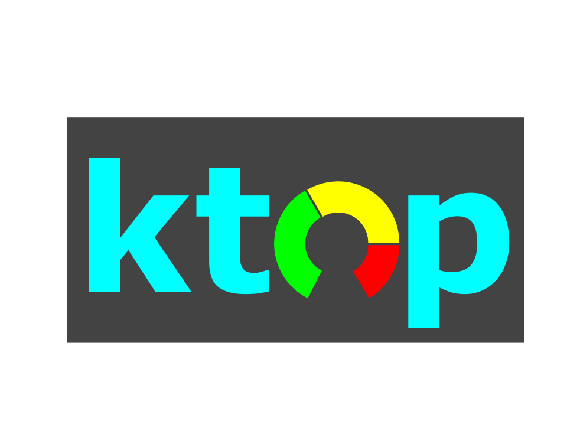
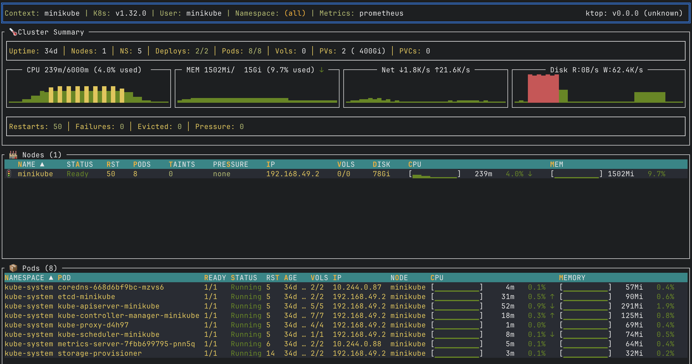

<p align="center">
    
</p>

<p align="left">
    
</p>

A `top`-like tool for your Kubernetes cluster.

Following the tradition of Unix/Linux `top` tools, `ktop` is a tool that displays useful metrics information about nodes, pods, and other workload resources running in a Kubernetes cluster.

## Features

* **Real-Time Monitoring** - Continuously updated view of nodes, pods, and containers
* **Interactive Table Controls** - Column sorting, live filtering (`/`), and custom column selection (`=`)
* **Pressure Stall Information (PSI)** - Cluster summary and node/pod detail stall sparklines for CPU, memory, and I/O pressure
* **Drill-Down Navigation** - Explore from cluster overview → node → pod → container logs
* **Zero Cluster Installation** - Runs locally using your kubeconfig; no agents or server-side components
* **Works Anywhere kubectl Works** - Connects through the Kubernetes API; no direct node access required
* **Streaming Container Logs** - Real-time logs with filtering, timestamps, line wrap, and full-screen mode
* **Ergonomic Shortcuts** - Integrated keyboard shortcuts help (`?` or `F1`) and clipboard resource copying (`y`)
* **Multiple Metrics Sources** - Support Prometheus for enhanced metrics, Metrics-Server, or no-metrics as fallback
* **Graceful Degradation** - Works even without metrics infrastructure by showing resource requests/limits
* **Session Directory & Config** - Automatic rotating session logs in `~/.ktop/logs/` and persistent configuration in `~/.ktop/config.yaml`
* **Single Binary** - Download and run; no dependencies beyond a valid kubeconfig

## Installation

### kubectl plugin

```bash
kubectl krew install ktop
kubectl ktop
```

Requires [krew](https://krew.sigs.k8s.io/docs/user-guide/setup/install/) plugin manager.

### Homebrew (macOS/Linux)

```bash
brew tap vladimirvivien/oss-tools
brew install ktop
```

### Go install

```bash
go install github.com/vladimirvivien/ktop@latest
```

### Binary download

Download prebuilt binary archives for Linux, macOS, and Windows (`.zip` and `.tar.gz`) from [GitHub Releases](https://github.com/vladimirvivien/ktop/releases/latest).

## Quick Start

With a valid kubeconfig file (`$KUBECONFIG` or `~/.kube/config`):

```bash
# Start ktop with default settings
ktop

# Use a specific context
ktop --context my-cluster

# Filter to a namespace
ktop --namespace production

# Start with custom initial table sort orders
ktop --sort-pods=-Memory --sort-nodes=+Name

# Use Prometheus for enhanced metrics
ktop --metrics-source=prometheus
```

Press `?` inside ktop at any time to open the keyboard shortcuts reference.

## Configuration & Session Logs

ktop stores state and diagnostic data under `~/.ktop/`:

- `~/.ktop/config.yaml` — Declarative user preferences for default metrics sources and customized table column subsets.
- `~/.ktop/logs/ktop.log` — Automatic rotating diagnostic session logs (retained up to 5 backups, 10MB each).

## Documentation

> See [ktop's documentation site](https://vladimirvivien.github.io/ktop/) for complete guides, CLI references, and architecture details.
